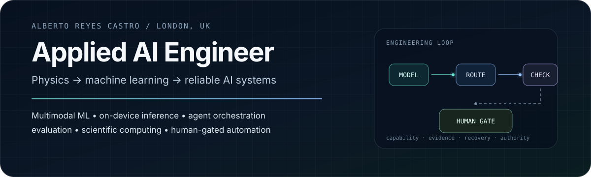
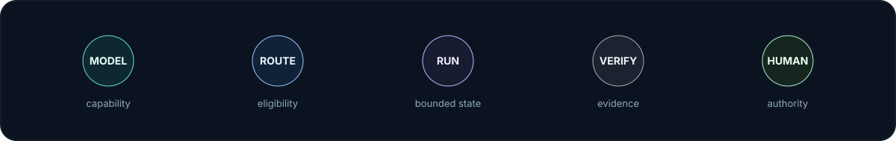

  

  &nbsp;
  &nbsp;
  

## Engineering reliable, efficient AI systems

I am an **Applied AI Engineer at TeachScribe**, completing an **MSc in Artificial Intelligence Technology with Advanced Practice at Northumbria University London**. With a **BSc in Physics** from the University of La Laguna, I approach AI through controlled experiments, measurement and explicit assumptions.

My work spans **multimodal and on-device ML, efficient inference, ML evaluation and reliable AI systems**. At TeachScribe, I designed, implemented, measured and delivered an Android image–text retrieval pipeline. Previously, I worked with Python and scientific communication at the **Instituto de Astrofísica de Canarias (IAC)**.

<table>
<tr>
<td width="50%" valign="top">

### Technical focus

- Multimodal and on-device machine learning
- Model selection, INT8 inference and embedding reuse
- ML evaluation and technical auditing
- Reliable agent orchestration
- Speech processing and scientific computing

</td>
<td width="50%" valign="top">

### Engineering principles

- Controlled comparisons and measurable outcomes
- Deterministic checks around probabilistic models
- Explicit ownership, bounded recovery and fail-closed state
- Reproducible evidence and human approval gates

</td>
</tr>
</table>

## Selected engineering projects

<table>
<tr>
<td width="50%" valign="top">

### [TeachScribe — On-Device Multimodal Retrieval](https://github.com/albertoreyescastro/teachscribe-on-device-multimodal-retrieval)

**Production-integrated applied ML · Android**

Benchmarked **five vision-language models**, selected TinyCLIP 39M/16 and deployed separate **INT8 ONNX** text/image encoders with native Kotlin preprocessing and RAM/SQLite embedding reuse. Retrieval stays on-device; teachers retain the final photo-selection decision.

**Measured on one Android tablet:** **441.07 ms median / 459.28 ms P95** over 108 cached searches; **74.77% smaller text encoder** after quantisation. Shipped within TeachScribe's **50+ UK-school product deployment** (product reach, **not measured feature adoption**).

[Explore the public case study and evidence →](https://github.com/albertoreyescastro/teachscribe-on-device-multimodal-retrieval)

</td>
<td width="50%" valign="top">

### [ModelHawk](https://github.com/albertoreyescastro/ModelHawk)

**ML notebook auditing · Deployed web application**

A Next.js/TypeScript tool that statically inspects Jupyter notebooks **without executing their code**. Deterministic checks flag potential data leakage, test-set reuse, threshold-tuning risks and reproducibility gaps. An optional AI examiner adds narrative guidance; PDF reports and production-container HTTP E2E tests support the workflow.

[Try the live demo →](https://modelhawk.onrender.com/) · [Inspect code and tests →](https://github.com/albertoreyescastro/ModelHawk)

*The free-tier demo may need to wake after inactivity.*

</td>
</tr>
<tr>
<td width="50%" valign="top">

### [Agent Control Center](https://github.com/albertoreyescastro/agent-control-center)

**Multi-agent orchestration and reliability engineering**

A **sanitised, interactive simulation** of a multi-agent control plane: capability-aware routing, execution leases, heartbeat tracking, quota fencing, bounded recovery, independent verification and a human merge gate.

The public demo explains architectural decisions; it is **not live operational telemetry** or a control interface.

[Explore the interactive demo →](https://albertoreyescastro.github.io/agent-control-center/)

</td>
<td width="50%" valign="top">

### [Adaptive Whisper Pipeline](https://github.com/albertoreyescastro/adaptive-whisper-transcription-pipeline)

**Hardware-aware speech inference**

A reproducible transcription workflow built on `faster-whisper` and CTranslate2, with CPU/CUDA-aware defaults, safe fallback, FFmpeg preprocessing, voice activity detection, fingerprinted caching, output checks and TXT/SRT export.

`CPU / INT8` · `CUDA / FP16` · `FFmpeg` · `VAD`

[Source and validation →](https://github.com/albertoreyescastro/adaptive-whisper-transcription-pipeline) · [Kaggle demo →](https://www.kaggle.com/code/albertoreyescastro20/adaptive-whisper-transcription-pipeline-demo)

</td>
</tr>
</table>

## Additional work and contributions

- **[IAC Scientific Publication ↔ Press Note Matching](https://github.com/albertoreyescastro/IAC-publication-press-note-matching)** — Reproducible English/Spanish scientific-text matching with RapidFuzz, evidence-based ranking and explicit human-review tiers; related to my IAC internship.
- **[Computational Physics — Numerical Methods](https://github.com/albertoreyescastro/computational-physics-numerical-methods)** — Scientific Python notebooks covering interpolation, numerical integration, ODE solvers and stochastic simulation.
- **[AIoT Smart Home — ESP32-S3](https://github.com/albertoreyescastro/AIoT-smart-home-esp32-wokwi)** — Simulation-based embedded C++ controllers, deterministic safety logic, Wokwi demos and a bounded TinyML experiment.
- **[Vizro/Dash open-source investigation](https://github.com/mckinsey/vizro/issues/1750#issuecomment-4603400692)** — Contributed reproduction and regression-isolation evidence for a tab-rendering issue; the maintainer's separate [fix PR #1752](https://github.com/mckinsey/vizro/pull/1752) was subsequently merged.
- **[Scientific publications and research](https://albertoreyescastro.github.io/#publications)** — IAC science-communication work and an English-language Physics thesis on ferroelectricity and ferroelasticity (**9.4/10**).

## Engineering approach

  

I design around **explicit execution criteria, bounded failure recovery, inspectable evidence and clear human decision points**. Reliability depends on how a system behaves when inputs, models or dependencies fall outside expected conditions.

My evaluation approach starts with a baseline and controlled comparisons. I select metrics that reflect the practical cost of failure and inspect individual errors alongside aggregate performance to understand where a system is reliable and where it needs improvement.

## Technical stack

| Area | Tools |
|---|---|
| **Machine learning and inference** | `Python` · `NumPy` · `SciPy` · `pandas` · `scikit-learn` · `ONNX Runtime` · `TinyCLIP` |
| **AI systems and application engineering** | `TypeScript` · `Next.js` · `React Native` · `Kotlin` · `SQLite` · `Docker` · `REST APIs` · `GitHub Actions` |
| **Speech inference and media** | `faster-whisper` · `CTranslate2` · `FFmpeg` · `VAD` · `CPU / CUDA` |
| **Scientific computing and development** | `Jupyter` · `Matplotlib` · `SymPy` · `LaTeX` · `SQL` · `Git` |
| **Embedded systems and AIoT** | `C++` · `ESP32-S3` · `Wokwi` · `Blynk` · `Edge Impulse` |

**Research interests:** Reliable and efficient multimodal systems · model compression and quantisation · on-device inference · retrieval reliability during model migration · evaluation methods that reveal failures hidden by aggregate metrics.

---

  <strong>Alberto Reyes Castro</strong> 
  Applied AI Engineer · Physics Graduate · MSc AI Technology Candidate · London, UK  
  <a href="mailto:albertoreyescastro20@gmail.com">Email</a> ·
  <a href="https://albertoreyescastro.github.io">Portfolio</a> ·
  <a href="https://www.linkedin.com/in/alberto-reyes-ba5546238">LinkedIn</a> ·
  <a href="https://www.kaggle.com/albertoreyescastro20">Kaggle</a>

