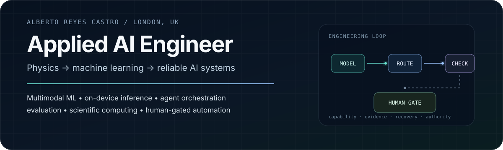

  

  &nbsp;
  &nbsp;
  

## I build the engineering around the model.

Model capability is only one part of a useful AI system. I focus on what happens **around inference**: hardware-aware execution, routing, failure handling, evaluation, reproducibility, trust boundaries and human control.

I work as an **Applied AI Engineer at TeachScribe** while completing an **MSc in Artificial Intelligence Technology with Advanced Practice at Northumbria University London**. My background in **Physics** shapes how I approach AI: define the system, measure what matters, make uncertainty explicit and test failure modes—not only the happy path.

<table>
<tr>
<td width="50%" valign="top">

### Current focus

- Multimodal & on-device ML
- Agentic AI & reliability engineering
- Speech / audio AI
- ML evaluation & technical tooling
- Efficient inference & model migration

</td>
<td width="50%" valign="top">

### Engineering principles

- Deterministic checks around probabilistic models
- Bounded recovery; explicit ownership and health
- Fail closed on unknown or stale state
- Reproducible evidence before human-controlled promotion

</td>
</tr>
</table>

## Selected engineering work

<table>
<tr>
<td width="50%" valign="top">

### [Agent Control Center](https://github.com/albertoreyescastro/agent-control-center)
**Resilient multi-agent orchestration / reliability engineering**

Capability-aware routing, leases and heartbeats, bounded recovery, separate verification, spend-safety constraints, a fail-closed publication boundary and a human merge gate.

[Live system →](https://albertoreyescastro.github.io/agent-control-center/)

</td>
<td width="50%" valign="top">

### [ModelHawk](https://github.com/albertoreyescastro/ModelHawk)
**ML notebook auditing / AI-assisted technical review**

Static Jupyter analysis that detects ML workflow signals and risks, produces structured findings, adds an AI examiner layer with provider fallbacks, and compiles LaTeX PDF reports.

`deterministic audit → evidence → AI examiner → PDF`

</td>
</tr>
<tr>
<td width="50%" valign="top">

### [Adaptive Whisper Pipeline](https://github.com/albertoreyescastro/adaptive-whisper-transcription-pipeline)
**Hardware-aware speech inference / robust local workflow**

A reusable `faster-whisper` pipeline with CPU/GPU-aware model selection, audio normalisation, VAD presets, anti-repetition safeguards, fingerprinted cache files, quality checks and TXT/SRT output.

`CPU / INT8` · `CUDA / FP16` · `FFmpeg` · `VAD`

</td>
<td width="50%" valign="top">

### [Computational Physics](https://github.com/albertoreyescastro/computational-physics-numerical-methods)
**Numerical methods / scientific computing**

Scientific Python implementations of interpolation, numerical quadrature, ODE solvers and stochastic simulation, including physical applications such as Planck's law.

`NumPy` · `SciPy` · `Matplotlib` · `SymPy`

</td>
</tr>
</table>

## How I think about AI systems

  

A strong model does not remove the need for systems engineering. I prefer architectures where **eligibility is explicit, failures are bounded, evidence is inspectable and automation stops where human authority is required**. I apply the same discipline experimentally: establish a baseline, control variables, choose metrics that match the real failure cost and inspect individual errors rather than relying only on aggregate scores.

## Working stack

| Area | Tools |
|---|---|
| **ML / inference** | `Python` · `NumPy` · `SciPy` · `pandas` · `scikit-learn` · `faster-whisper` · `ONNX` |
| **AI systems** | `TypeScript` · `Next.js` · `JavaScript` · `Node.js` · `REST APIs` · `Ollama` · `GitHub Actions` |
| **Scientific / technical** | `Jupyter` · `Matplotlib` · `SymPy` · `LaTeX` · `SQL` · `Git` |
| **Embedded / AIoT** | `C++` · `ESP32-S3` · `Wokwi` · `Blynk` |

**Research interests:** reliable and efficient multimodal systems · model compression / quantization · on-device inference · retrieval reliability during model migration · evaluation methods that expose failure cases hidden by averages.

---

  <strong>Alberto Reyes Castro</strong> 
  Applied AI Engineer · Physics graduate · MSc AI Technology · London, UK  
  <a href="mailto:albertoreyescastro20@gmail.com">Email</a> ·
  <a href="https://albertoreyescastro.github.io">Portfolio</a> ·
  <a href="https://www.linkedin.com/in/alberto-reyes-ba5546238">LinkedIn</a> ·
  <a href="https://www.kaggle.com/albertoreyescastro20">Kaggle</a>

